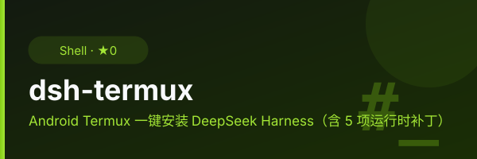

<p align="center">
  
</p>

<div align="center">
  
</div>

# dsh-termux

One-command installer for [DeepSeek's `@deepseek-ai/dsh`](https://www.npmjs.com/package/@deepseek-ai/dsh) CLI on **Termux (Android)**, including the runtime patches needed to actually run it.

Built for my own phone. If it helps yours, use it freely (MIT, inherited from
the upstream [lilyco-42/dsh-termux](https://github.com/lilyco-42/dsh-termux)).

## Why this exists

`npm install -g @deepseek-ai/dsh` installs but does not run on Termux. Twelve
independent incompatibilities have to be fixed:

| # | Package / feature | Problem | Fix |
|---|---|---|---|
| 1 | `node-pty` | node-gyp copies `process.config.variables.OS = "android"` into `config.gypi`, making gyp reference the undefined `android_ndk_path`. | Patch node-gyp to drop the `OS` variable so gyp infers `linux`. |
| 2 | `koffi` | `base.cc` calls `statx()`, hidden by bionic below API 30; clang targets `android24`. | Compile with `--target=aarch64-unknown-linux-android30`. |
| 3 | `sharp` | No prebuilt binding for `android-arm64`. | Install system `libvips` and build sharp against it. |
| 4 | HMR / profile resolution | Needs Node internals; the published `node-addon-require-builtin` ships darwin/linux/win prebuilds only and no sources, so it fails closed on Android. | Replace the addon's JS entry with a `--expose-internals` shim and add the flag to the `dsh` shebang. |
| 5 | `dsh-session-persistence-jsonl` | Locks its log through the native `flock()` in `node-addon-system`, which ships no android binding; `tryLockExclusive()` throws `ERR_FLOCK_UNSUPPORTED_PLATFORM` and every session write dies. | Stub the flock entry to a no-op (single-user host, one dsh process). |
| 6 | `session-persistence-jsonl` | Publishes logs with a hard `link()`, forbidden on Android (`EACCES`). | Switch the atomic publish to `rename()`. |
| 7 | `attachment-local` | Fsyncs every ancestor directory up to `/` for crash durability, but the `untrusted_app` SELinux domain cannot `open("/data/data")`; publishing also uses `link()`. | Tolerate unopenable ancestors and fall back to `rename()`. Without this, `read_image` cannot store an image. |
| 8 | `fs-local` | The `write`/`edit` tools publish a **new** file with `link()` (no-replace semantics), which Android also refuses (`EACCES`). | Fall back to `rename()`; the guard still refuses to overwrite an existing file. Without this, every create-file write fails. |
| 9 | `@vscode/ripgrep` | No `@vscode/ripgrep-android-*` platform package exists, and the linux prebuilds are glibc-linked (unusable on bionic); glob/grep fail with `ripgrep launch failed`. | Patch the resolver to fall back to the system `rg` (`pkg install ripgrep`). |
| 10 | `dsh-subprocess-local` | Builds its process inspector for linux/darwin only; Termux reports platform `android`, so pty sessions throw `terminal inspection is unsupported on platform android`. | Route android to the linux inspector — the `/proc` interface is shared. |
| 11 | web auth | The web UI gates `index.html` behind a per-run launch token — friction with no protection on a loopback-only bind (`127.0.0.1:3080`). | Patch the fence so loopback requests skip it; non-loopback authorities keep the token. |
| 12 | sandbox backend | Android has no bubblewrap/Landlock backend, so the default `workspace-write` sandbox cannot start the bash tool; pinning `danger-full-access` also needs a matching approval preset. | Profile patch (`~/.dsh/profiles/web/cordis.patch.yml`) pins `danger-full-access` plus a custom `termux-unconfined` preset (keeps approval prompts). |

## Install

```bash
pkg install -y git
git clone https://github.com/ak-a-ra/dsh-termux.git
cd dsh-termux
bash install.sh
```

Or a single command:

```bash
bash <(curl -fsSL https://raw.githubusercontent.com/ak-a-ra/dsh-termux/main/install.sh)
```

## Verify

```bash
dsh --version
dsh web            # serves the browser UI
dsh --profile headless "hello"   # one task, prints result, exits
```

You need a DeepSeek API key (`export DEEPSEEK_API_KEY=...`, or set it in the
web UI's Models page).

## Requirements

- Termux (the script installs everything else via `pkg`).
- Android 11 (API 30) or newer — required at runtime because `koffi` is built
  against API 30 (`statx`).

## Troubleshooting

**`dsh: warning: 1 entry did not activate` / `ENOSPC: System limit for number of
file watchers reached`** — Android gives every app UID one shared inotify
budget (unreadable, varies by kernel), and dsh web needs ~7 watches for the
profile/HMR watchers. The error means some *other* process of the same UID
held the budget at that moment. It is non-fatal: the web UI serves, only
hot-reload of profile/plugin edits is off (restart `dsh web` instead).
Remedies: run a single `dsh web` instance at a time, close other watcher-heavy
processes, and start `dsh web` again.

**`dsh web authentication required`** — loopback (`http://127.0.0.1:3080/`,
`localhost`, `[::1]`) serves without a token (installer patch). A token is
still required from non-loopback authorities (e.g. LAN access via
`--host 0.0.0.0`): open the full URL printed by `dsh web`; bookmarks and old
tabs carry stale tokens.

## Repo layout

- `install.sh` — the 15-step installer (all patches idempotent, `# dsh-tested:` pin on top).
- `.github/` — CI: structural checks, patch dry-run against a resolved upstream tree, 3-day release cron.
- `plugins/dsh-graphview/` — locally vendored web plugin (graph memory view), linked into the profile by hand (`dsh plugin --profile web add link:...`).
- `docs/` — logo/banner.

## Releases & upstream tracking

CI checks npm for a new `@deepseek-ai/dsh` every 3 days:

- The `install.sh` patch blocks are dry-run against the **resolved** upstream
  package (`sharp`, node-gyp, `node-addon-require-builtin` shim, ripgrep,
  subprocess inspector, session persistence, attachment store, fs-local,
  shebang).
- If every anchor still matches, a `dsh-X.Y.Z` release is cut with the tested
  `install.sh` attached — see [Releases](https://github.com/ak-a-ra/dsh-termux/releases).
- If an anchor broke, an issue is opened instead and no release ships.
- The `# dsh-tested:` pin at the top of `install.sh` records the upstream version
  the patches were last verified against.

## What the script does

1. Installs `nodejs`, `build-essential`, `clang`, `cmake`, `ninja`, `python`, `libvips`.
2. Patches node-gyp's `create-config-gypi.js` (idempotent).
3. Installs `@deepseek-ai/dsh` globally with `CFLAGS`/`CXXFLAGS` targeting `android30`.
4. Replaces `node-addon-require-builtin`'s JS entry with a `--expose-internals` shim, and stubs `node-addon-system/flock` (no android binding) so session writes stop dying.
5. Builds `sharp` against the system `libvips`.
6. Patches `session-persistence-jsonl` to use `rename()` instead of `link()`.
7. Patches `attachment-local` (ancestor-fsync tolerance + `link()` fallback).
8. Rewrites the `dsh` shebang to `node --expose-internals`.
9. Patches `fs-local` so new files are published without `link()`.
10. Patches `@vscode/ripgrep` to fall back to the system `rg` on android.
11. Patches the `dsh-subprocess-local` inspector to treat android as linux.
12. Opens the web UI on loopback: `http://127.0.0.1:3080/` serves without the
    per-run token (non-loopback authorities keep the token fence).
13. Installs the web plugins into the web profile — `dsh-web-mobile`
    (mobile UI for screens <1024px: bottom sheets, notch safe-area handling,
    gzipped session history; desktop stays untouched), `dsh-web-search-pro`
    and `@anweat/dsh-browser`.
14. Writes `~/.dsh/profiles/web/cordis.patch.yml` pinning the `danger-full-access`
    sandbox with a custom approval preset (no OS sandbox backend on Android).
15. Prompts you to paste your `DEEPSEEK_API_KEY` (input hidden), saves it to
   `~/.bashrc`, and exports it for the current shell. If you press Enter with
   nothing, it falls back to scanning for an existing key (env, dsh's
   credentials store, shell rc files).

All post-install patches are idempotent, so re-running `install.sh` is safe.

To set the key non-interactively (e.g. when piping the script), pass it in the
environment; interactively, the script just asks you to paste it:

```bash
DEEPSEEK_API_KEY=sk-... bash install.sh
```
